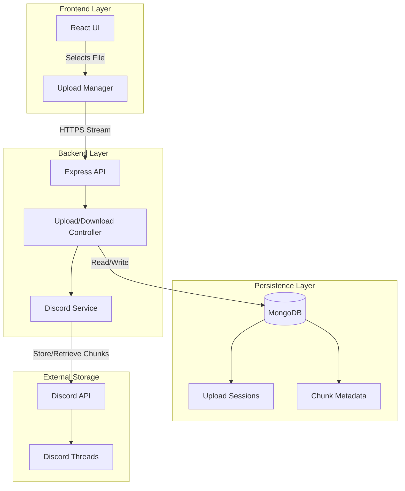
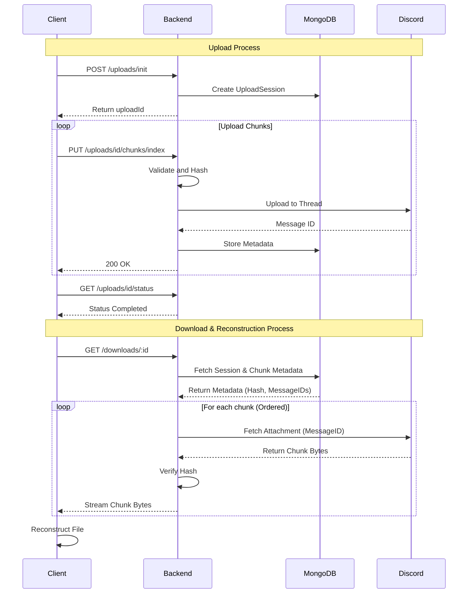

# Discord Storage System v2.0

A modern, modular Discord-based file storage system with a React Web App, chunked uploads, manifest-based metadata, and reliable file reconstruction.

## ✨ Features

- **Web Interface**: Modern React-based UI with Drag & Drop, Progress Bars, and File Management.
- **Chunked Uploads**: Automatically splits large files into ≤25MB chunks for Discord compatibility.
- **Resumable Uploads**: Uploads can be paused, resumed, and recovered after network failures.
- **Manifest-Based Metadata**: Tracks file information, chunk locations, and integrity in MongoDB.
- **Reliable Reconstruction**: Validates and reconstructs files from chunks with hash verification.
- **Secure**: Uses Discord as a storage backend while keeping metadata separate.

## 🏗️ Architecture

The system consists of a React Frontend, a Node.js/Express Backend, MongoDB for metadata, and Discord for chunk storage.



### Core Components

- **Frontend (Client)**: Handles file selection, slicing, and concurrent upload management.
- **Backend (API)**: Orchestrates upload sessions, validates chunks, and manages Discord interactions.
- **Database (MongoDB)**: Stores `UploadSession` state and `Chunk` metadata (message IDs, hashes).
- **Storage (Discord)**: Acts as the raw object storage for binary chunks.

## 🔄 Upload Flow

The upload process ensures reliability and resumability through a session-based approach.



## 🚀 Quick Start

### Prerequisites

- Node.js 18.0.0 or higher
- MongoDB instance (local or cloud)
- Discord Bot Token

### Installation

1. **Clone and Install Dependencies**
   ```bash
   git clone <repository-url>
   cd discord-storage-system
   npm install
   cd client
   npm install
   ```

2. **Environment Configuration**
   Create a `.env` file in the project root:
   ```env
   # Discord Configuration
   DISCORD_TOKEN=your_discord_bot_token
   GUILD_ID=your_guild_id
   CHANNEL_ID=your_channel_id
   
   # Database Configuration
   MONGODB_URI=mongodb://localhost:27017/discord-storage
   
   # Server Configuration
   PORT=3000
   
   # Optional
   USE_MOCK_DISCORD=false # Set to true for testing without Discord
   ```

3. **Start the System**

   **Backend:**
   ```bash
   # In root directory
   npm run server
   ```

   **Frontend:**
   ```bash
   # In client directory
   npm run dev
   ```

4. **Access the App**
   Open [http://localhost:5173](http://localhost:5173) in your browser.

## 📁 Project Structure

```
discord-storage-system/
├── src/
│   ├── controllers/        # Request handlers
│   ├── models/             # Mongoose schemas (UploadSession, Chunk)
│   ├── routes/             # Express routes
│   ├── services/           # Discord & Storage logic
│   └── server.js           # Backend entry point
├── client/                 # React Frontend
│   ├── src/
│   │   ├── components/     # UI Components
│   │   ├── services/       # Upload Manager Logic
│   │   └── App.jsx         # Main Application
│   └── vite.config.js      # Vite Configuration
└── test/                   # Integration Tests
```

## 🔧 Configuration

### Environment Variables

| Variable | Description | Default |
|----------|-------------|---------|
| `DISCORD_TOKEN` | Discord bot token | Required |
| `GUILD_ID` | Discord server ID | Required |
| `CHANNEL_ID` | Discord channel ID | Required |
| `MONGODB_URI` | MongoDB connection string | `mongodb://localhost:27017/discord-storage` |
| `PORT` | Backend server port | `3000` |
| `USE_MOCK_DISCORD`| Enable mock mode for testing | `false` |

## 🤝 Contributing

1. Fork the repository
2. Create a feature branch
3. Make your changes
4. Add tests if applicable
5. Submit a pull request

## 📄 License

ISC License - see LICENSE file for details
